# Project Eidolon

**A two-seat light trainer designed to beat the Hansa-NG, with every number traceable to code.**

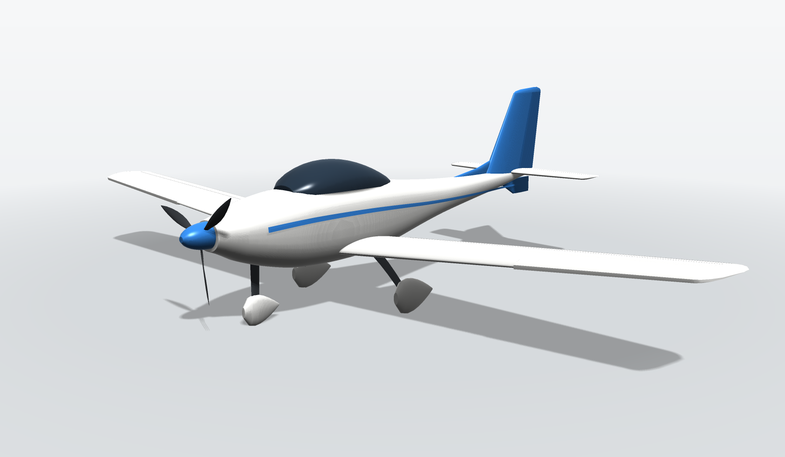

Eidolon is a first-semester conceptual design of a 750 kg, two-seat, single-engine trainer. It sits in the same class as India's CSIR-NAL **Hansa-NG**. Every number in this repository comes out of one Python pipeline: airfoils, wing, structure and mass, drag, propeller, engine choice, tail, CG, performance, loads, landing gear and the 3-D model. Every chosen value is the result of a study you can re-run with one command.

> **Status:** preliminary design (conceptual phase). Results are outputs of calibrated engineering models, not flight-test or wind-tunnel data. [Methods & validation](docs/METHODS_AND_VALIDATION.md) lists what each model can and cannot claim.

---

## The idea in one line: calibrate on real aircraft, then beat them

Every conceptual-design model has bias. So we first run our models on real aircraft with published data, and only then on Eidolon.

- **Mass.** A bottom-up count of sized structure, plus one measured unknown: the "class allowance" that a bottom-up count always misses, measured on three certified trainers (Hansa-NG, Aquila A210, DV20 Katana) as **148.8 ± 11.6 kg**. Leave-one-out predicts each of them within −3.7 % to +2.1 %.
- **Performance.** Two factors fitted on the Hansa-NG's cruise speed and climb rate. The models then predict five other published Hansa-NG numbers within **±15 %**.

Eidolon then goes through the **identical** models, so whatever bias is left mostly cancels and the comparison is like-for-like.

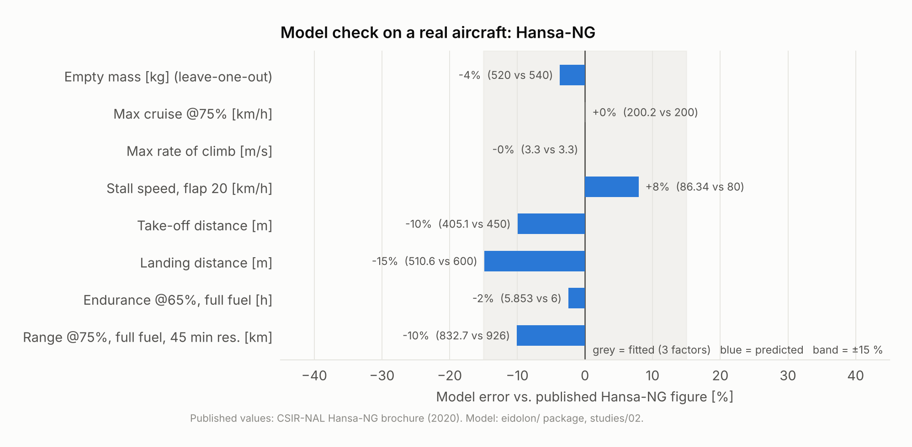

## Eidolon v1 against the Hansa-NG

| Same models, same calibration | Hansa-NG | **Eidolon v1** | Change |
|---|---:|---:|---:|
| Fuel per 100 km at 200 km/h | 9.35 L | **7.84 L** | **−16 %** |
| Range at 200 km/h, 2 × 77 kg + 10 kg, 45-min reserve | 713 km | **803 km** | +13 % |
| Cruise speed at 75 % power, 1500 m | 200 km/h | **216 km/h** | +8 % |
| Max rate of climb, sea level | 3.30 m/s | **3.70 m/s** | +12 % |
| Take-off distance to 15 m | 405 m | **357 m** | −12 % |
| Stall speed, landing flap | 86 km/h* | **81 km/h** | −6 % |
| L/D max | 12.8 | **15.0** | +17 % |
| Parasite drag coefficient CD0 | 0.0332 | **0.0263** | −21 % |
| Empty mass | 526 kg | **530 kg** | +1 % |
| Spin screen (Bowman TDPF, ≥ 200 × 10⁻⁶) | — | **481 × 10⁻⁶** | passes |

\*Model value. The model over-predicts Hansa-NG's published 80 km/h by 8 %, so Eidolon's 81 km/h is conservative. It is below the CS-VLA limit of 83 km/h.

**Is the advantage real?** We ran the comparison 800 times in Monte Carlo, with every uncertain assumption drawn wide, once with priors biased against Eidolon and once neutral ([study 14](studies/14_sensitivity.py)).

- **Fuel burn:** Eidolon burns less in **100 %** of samples in both runs (−4 % to −14 % P5-P95, pessimistic).
- **Range with two crew:** better in **66 %** (neutral) and **30 %** (pessimistic). At a fixed 750 kg, every kilogram of empty mass is a kilogram of fuel, about **18 km** of range, and Eidolon's lead vanishes if its empty mass grows 5 kg beyond the estimate.

So the fuel-burn advantage is firm; the range advantage is **conditional on hitting the mass estimate**, which makes a weight-tracking budget the first job of the next phase.

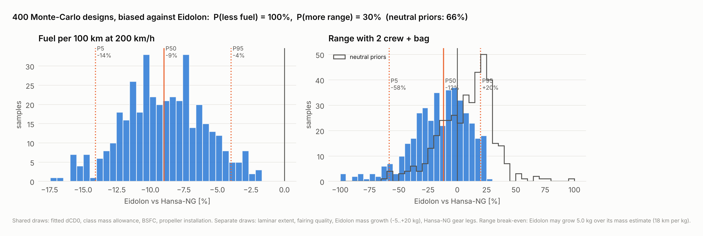

---

## Design decisions, each with its evidence

| # | Decision | Why (short) | Evidence |
|---|---|---|---|
| [D1](docs/DESIGN_DECISIONS.md#d1-mission-mtow-and-certification-basis) | 750 kg MTOW, 2 seats, CS-VLA envelope, +4.4 g utility loads | Same class as Hansa-NG, fair comparison; spin-training loads | studies 02, 12 |
| [D2](docs/DESIGN_DECISIONS.md#d2-mass-is-estimated-bottom-up-and-the-unknown-is-measured) | **Bottom-up mass** + measured class allowance, as a random variable | Sees Eidolon's differences from Hansa; P5-P95 500-560 kg | study 01 |
| [D3](docs/DESIGN_DECISIONS.md#d3-wing-section-naca-63-415-blending-to-63-412) | NACA 63-415 root → 63-412 tip | Laminar to ~35-50 % chord at cruise CL; 25 % deeper spar | study 03 |
| [D4](docs/DESIGN_DECISIONS.md#d4-wing-planform-1325-m-115-m-taper-06-2-washout) | **13.25 m², 11.5 m span (AR 10)**, taper 0.6, −2° washout | Fuel-burn optimum of a carpet of fully closed aircraft, range ≥ 800 km | studies 04, 05 |
| [D5](docs/DESIGN_DECISIONS.md#d5-spin-resistant-drooped-outboard-leading-edge) | **Drooped outboard leading edge** | Ailerons stay 100 % unstalled 3° past first stall (37.5 % without) | study 04 |
| [D6](docs/DESIGN_DECISIONS.md#d6-tail-conventional-low-tail-ventral-strake-40-elevator) | **Conventional low tail + ventral strake, 40 % elevator** | 6 configurations re-closed; T-tail can't rotate before lift-off; strake triples spin damping | studies 09, 10 |
| [D7](docs/DESIGN_DECISIONS.md#d7-drag-reduction) | Faired gear, laminar wing, compact fuselage | −16 % parasite drag area; the gear fairings are the biggest item | study 06 |
| [D8](docs/DESIGN_DECISIONS.md#d8-engine-rotax-912-isc) | **Rotax 912 iSc** (vs 912 ULS, 914, 915 iS, UL520iS) | Each engine re-closed in its own airframe. The DarkAero 1's UL520iS leaves 10 kg of fuel with two crew | study 08 |
| [D9](docs/DESIGN_DECISIONS.md#d9-propeller-175-m-3-blade-constant-speed) | 1.75 m, 3-blade, constant speed | BEMT checked against the momentum limit; 81 % installed in cruise | study 07 |
| [D10](docs/DESIGN_DECISIONS.md#d10-glass-fibre-leaf-spring-gear-with-piezo-health-monitoring) | S-glass leaf-spring gear with piezo health monitoring | Lightest spring material (σ²/Eρ); piezo logs every landing, but can absorb only 0.04 % of it | study 13 |

Appendix concept: [hybrid take-off boost for 45 °C airfields](docs/hybrid_boost_concept.md) (study 15).

## What makes it different

- **Spin-resistant by design.** Washout, a drooped outboard leading edge and a ventral strake, each screened with a published criterion, for a trainer that students will stall and spin.
- **A wing the old statistics would never have chosen.** Sizing the carbon spar instead of using a fitted equation made span cheap, and the optimum moved from 10.25 m to 11.5 m.
- **A landing gear that reports on itself.** Piezo films log the sink rate of every landing and flag hard ones; PZT wafers can find damage in the composite leaf between inspections.
- **CAD that follows the numbers.** Change the design, re-run, and the Fusion 360 solids, viewer and renders follow ([docs/CAD.md](docs/CAD.md)).

## How the pipeline closes the design

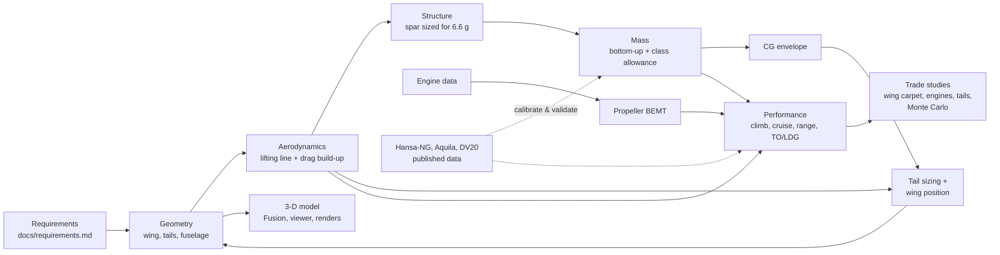

The loop `geometry → mass → CG → tail/wing position → geometry` repeats until it converges (`eidolon/design.py`).

## The studies

| # | Study | Main output |
|---|---|---|
| 01 | Mass estimation | bottom-up mass, class allowance, leave-one-out, mass distribution |
| 02 | Calibrate on Hansa-NG | drag and climb factors, validation against 6 published numbers |
| 03 | Airfoil selection | section geometry and polars |
| 04 | Wing lifting line | span loading, stall progression, washout, drooped LE |
| 05 | Wing sizing | area × span carpet of closed aircraft |
| 06 | Drag build-up | component drag areas, waterfall vs Hansa-NG |
| 07 | Propeller | BEMT, 2 vs 3 blades |
| 08 | Engine trade | 5 engines, each in its own closed airframe |
| 09 | Tail configuration | 6 tails, spin and deep-stall screens, tail height, elevator chord |
| 10 | Stability and CG | neutral point, CG envelope, tail sizing criteria |
| 11 | Performance | head-to-head, power curves, payload-range |
| 12 | V-n diagram | CS-23 manoeuvre and gust envelope |
| 13 | Landing gear | leaf-spring material trade, piezo assessment |
| 14 | Sensitivity | Monte Carlo (pessimistic and neutral), tornado |
| 15 | Hybrid boost | hot-day take-off and climb with electric boost |
| 16 | 3-D geometry | Fusion script data, STL, viewer bundle, renders, three-view |

## Run it

```bash
pip install -r requirements.txt      # numpy >= 2, matplotlib, pytest
python3 -m pytest -q                 # 14 verification tests
python3 run_all.py                   # all 16 studies, about 4 minutes; figures land in results/
python3 run_all.py 05 09             # just the wing carpet and the tail trade
```

The 3-D model is regenerated by study 16 ([docs/CAD.md](docs/CAD.md)):
- `cad/fusion/Eidolon/` — a Fusion 360 script that lofts every body as a parametric solid
- `cad/generated/*.stl` — one mesh per body
- `docs/viewer/` — an interactive web viewer. Enable GitHub Pages on `/docs` to publish it.

## Repository map

```text
eidolon/            the design toolkit (one module per discipline, equations in each docstring)
studies/            16 numbered studies; each writes figures + CSV/JSON into results/<study>/
results/            every figure and table in this README, regenerated by run_all.py
docs/               requirements, design decisions, methods & validation, CAD, Q&A, concepts
docs/viewer/        interactive 3-D viewer (three.js), loads model.json + specs.json
cad/                Fusion 360 script + geometry; cad/generated/ = STL from the design closure
xflr5/              airfoil coordinates and XFLR5 projects (source data for the wing)
scripts/            first-iteration scripts (constraint sketch, BEMT, landing screen), kept for history
tests/              verification tests (ISA, lifting-line textbook cases, momentum bound, spar sizing, closure)
```

## Gallery

| | |
|---|---|
| 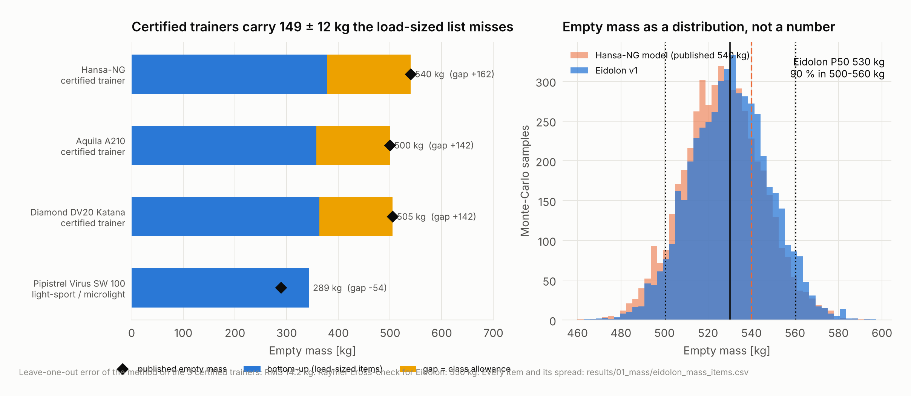 | 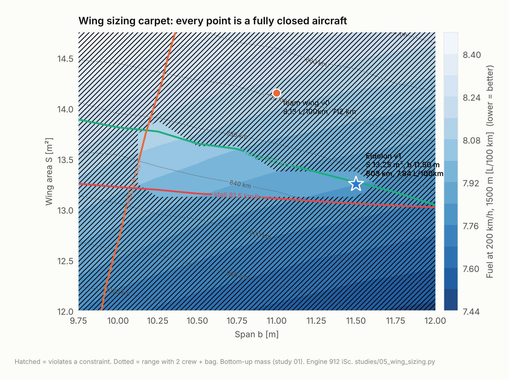 |
| 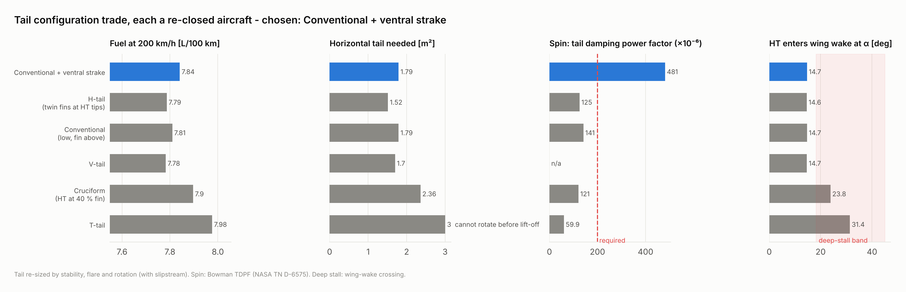 | 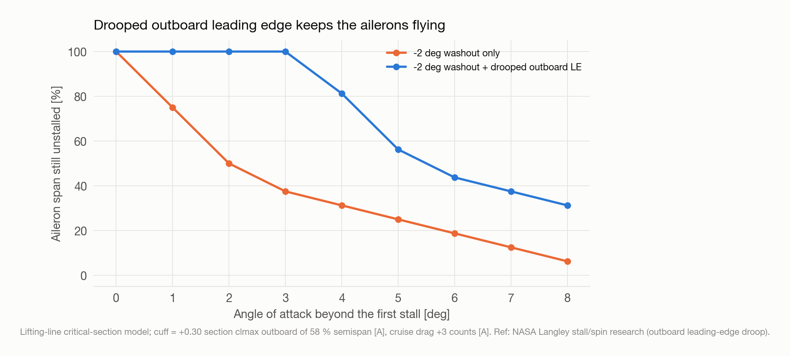 |
| 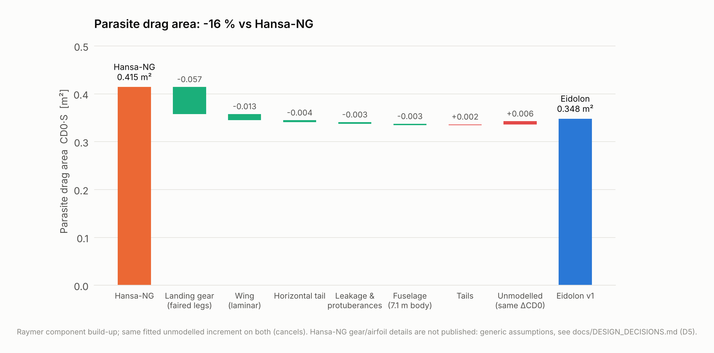 | 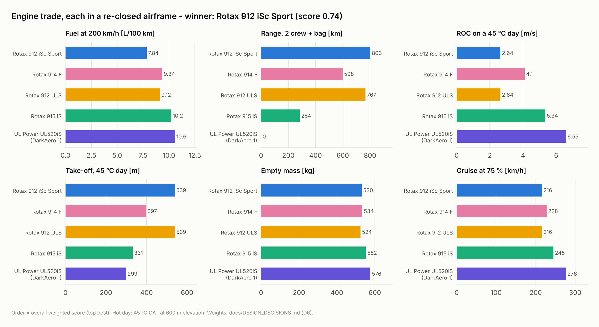 |
| 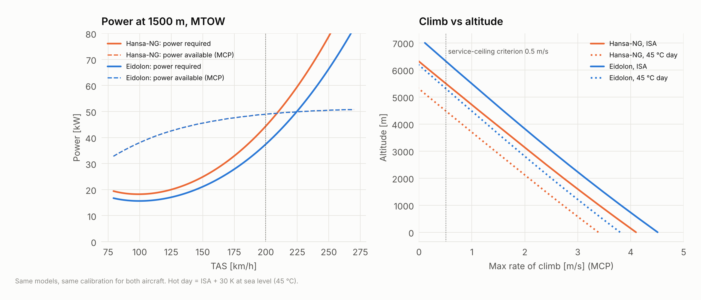 | 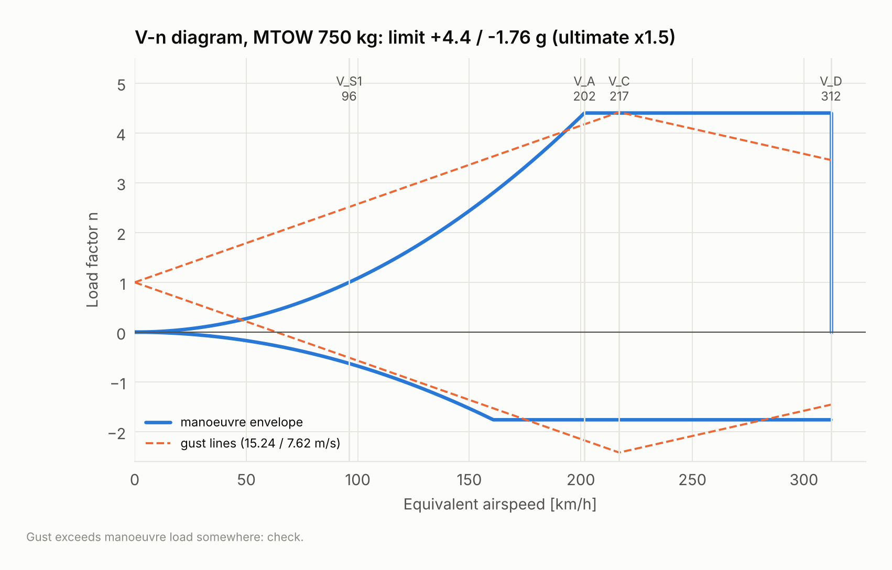 |
| 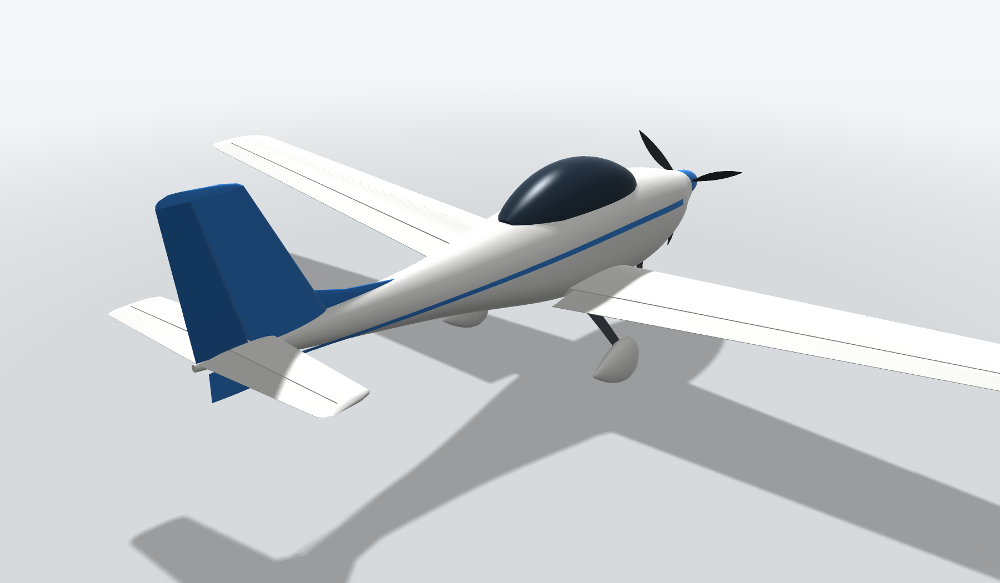 | 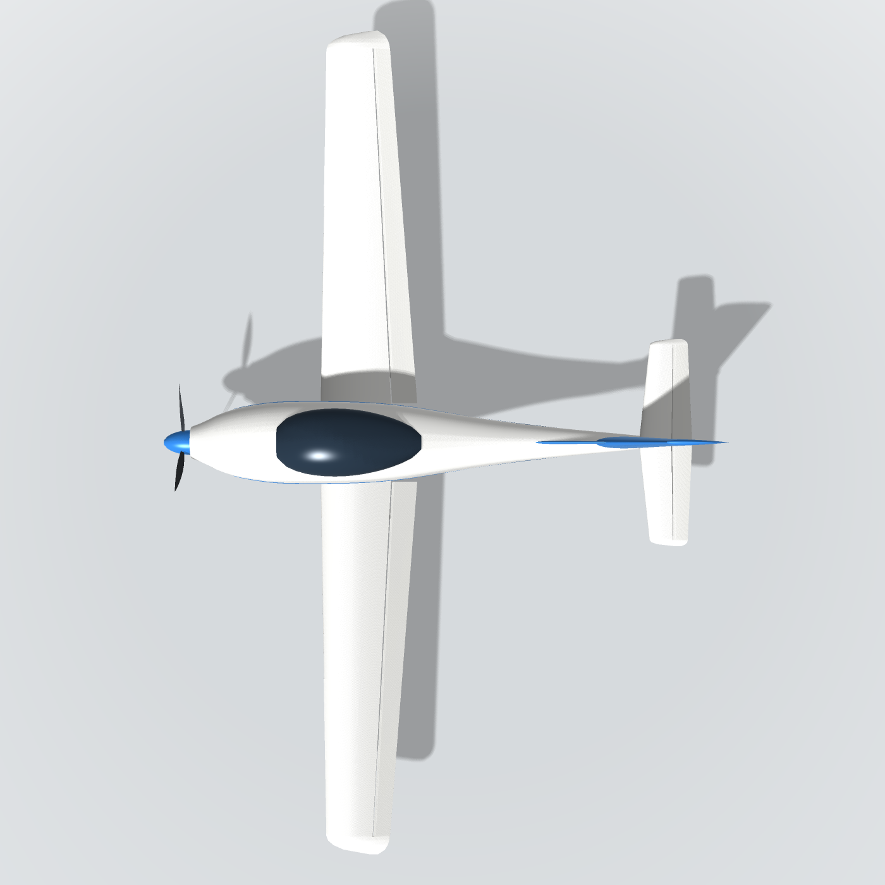 |

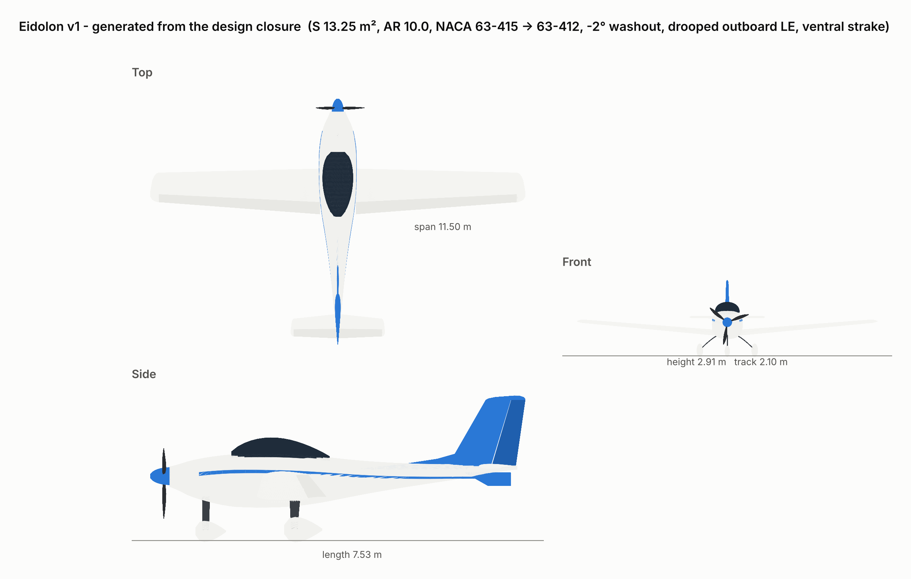

## Engineering principles we kept to

- Requirements are not results. Assumptions are tagged `[A]` in the code where they are made.
- Every figure carries its source and method in a footer.
- A model is believed only as far as it has been checked (see `tests/` and studies 01-02).
- Comparisons use identical models and conditions for both aircraft.
- Unknowns are named and given a spread, not hidden in a factor.
- When the analysis disagreed with an earlier choice (wing span, tail size, piezo damping, BEMT efficiency, 25 L tank), the analysis won and the change is recorded.

## References

- CSIR-NAL, *Hansa-NG* brochure (2020), nal.res.in
- D. P. Raymer, *Aircraft Design: A Conceptual Approach*, 6th ed., AIAA, 2018
- E. Torenbeek, *Synthesis of Subsonic Airplane Design*, Delft UP, 1982
- J. D. Anderson, *Fundamentals of Aerodynamics*, 6th ed., McGraw-Hill
- I. H. Abbott & A. E. von Doenhoff, *Theory of Wing Sections*, Dover, 1959
- S. Gudmundsson, *General Aviation Aircraft Design*, 2nd ed., Elsevier, 2022
- B. W. McCormick, *Aerodynamics, Aeronautics and Flight Mechanics*, Wiley
- T. H. G. Megson, *Aircraft Structures for Engineering Students*, Elsevier
- J. S. Bowman Jr., *Summary of spin technology as related to light general-aviation airplanes*, NASA TN D-6575, 1971
- EASA CS-VLA and CS-23 (Amdt. 4 and earlier load-case paragraphs 23.333-23.473)
- Rotax 912 iS/iSc and 915 iS data sheets (flyrotax.com); ULPower UL520iS data (ulpower.com)
- M. Nita & D. Scholz, *Estimating the Oswald factor from basic aircraft geometrical parameters*, DLRK 2012
- N. W. Hagood & A. von Flotow, *Damping of structural vibrations with piezoelectric materials and passive electrical networks*, J. Sound Vib. 146, 1991
